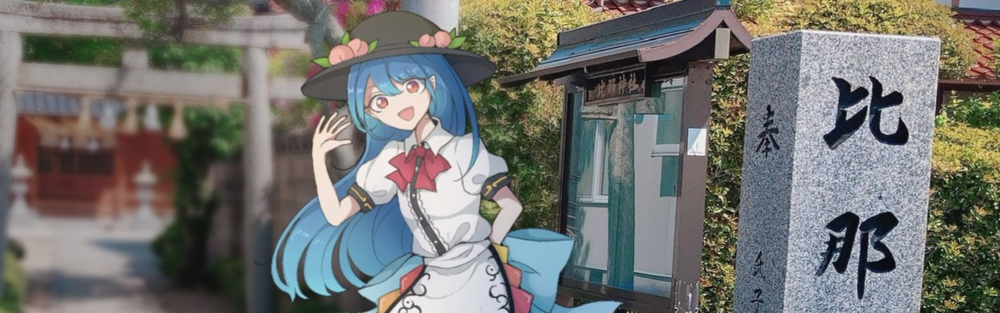

# 👋 Hallo, I'm Horstaufmental!

<a href="https://x.com/Mxx_459/status/1522906505611456514" title="Click to view image's source" target="_blank" align="center">
  <picture>
    
  </picture>
</a>

## About me

Just a humble man interested in many talents and topics, particularly about computers and nuclear power plants.

What I've hosted here are just tinkering and experimenting with code and stuffs, rare times that I focus on big (and productive) projects.

I have gathered quite a lot of experiences with many programming languages, but I'm mostly confident with:
>  - **Luau**, **C**, **Rust**

Asides from personal projects, I also work for:
>  - DeviousFairyCirno's [Touhou: War for Gensokyo](https://www.roblox.com/communites/34928969)
>  - AviatorsPaektu's [Democratic People's Republic of Korea](https://www.roblox.com/communities/34213080)
>  - FranzEulenberg's [Kingdom of Italy](https://www.roblox.com/communities/761858393)

Some notable stuffs I used to work for includes:
>  - [Realistic Boiling Water Reactor](https://www.roblox.com/communities/16332057)\'s Brzegowa Hydroelectric

## Current Projects

  <picture>
    
  </picture>

>[!NOTE]
>The (game) development is currently on hiatus, only lore/story are being worked at the moment.

>*Built in 2011 by the Moriya Shrine Foundation with the collaboration of the Chireiden, it is stationed underground below the Former Hell and Palace of Earth Spirits, the power plant has been the main source of electricity for the whole of Gensokyo ever since its first operations.*

A Roblox experience about nuclear power plant simulation, intended to simulate the operations of a CANDU reactor with an arcade-realistic style in an environment set in the Touhou Project universe.

More information can be found [here.](https://horstaufmental.cc/ynpp)
